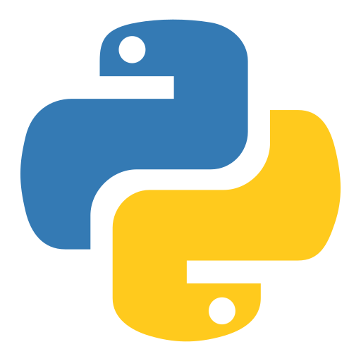

## Hi 👋 I'm Alex!

### ✨ About me

I'm a staff engineer at [@userledio](https://github.com/userledio), based in the UK, where I lead AI initiatives across the product. I'm passionate about infrastructure, developer experience, system design and agentic technologies, and about building tools and systems that make engineering more sustainable, safe and fun. In my spare time, I'm building **Hash**, a programming language and tooling ecosystem.

### 🔭 I'm currently working on

<!-- - [x] [**feds01.github.io**](https://feds01.github.io) - My personal website -->

-  [**Zenith**](https://github.com/feds01/zenith): a language-agnostic architecture linter for monorepos, built for humans and agents and written in . You declare contracts such as layers, forbidden dependencies and public entry points, and `zenith check` points at the import, or chain of imports, that breaks one. Read the user guide [here](https://feds01.github.io/zenith/)!

-  **Bracketlint**: a linter and formatter for Jinja, Nunjucks, Django, Twig and Liquid templates, written in . Install it with npm, Homebrew or a prebuilt binary.

-  **Durachok**: an online game for playing Durak, a popular Russian card game. Built with
   + , including some cool libraries: `@tanstack/router`, `@tanstack/react-query`, `socket.io`.

-  **Hash** programming language

  - [`compiler`](https://github.com/hash-org/hashc): the core Hash compiler, `hashc`, written in .
  - [`spec`](https://github.com/hash-org/spec): the Hash language specification, written in Sphinx and . Read all about it [here](https://hash-org.github.io/spec/)!
  - [`metrics`](https://github.com/hash-org/metrics): the Hash compiler metrics collection system, written in .

-  **Graphika**: a toy graphing library written in pure , as an alternative to `Chart.js` and other charting libraries.

-  **teamsearch**: a `CODEOWNERS`-aware code search tool, written in .

### 🧰 Developer experience tooling

I lead developer experience at [@userledio](https://github.com/userledio), and I build tools on the side to make engineering faster and safer:

- **[Zenith](https://github.com/feds01/zenith)**: a language-agnostic architecture linter that enforces import boundaries in monorepos
- **[prbot](https://github.com/feds01/prbot)**: a Slack and Discord bot that reacts to GitHub PR links with emoji showing each PR's live status
- **[teamsearch](https://github.com/feds01/teamsearch)**: a `CODEOWNERS`-aware code search tool
- **[bracketlint](https://github.com/feds01/bracketlint)**: a linter and formatter for Jinja, Nunjucks, Django, Twig and Liquid templates

### 🌱 I'm currently exploring

- **Agentic AI**: LLM agents, tool calling, evals and MCP servers (Mastra, Vercel AI SDK)
- **Retrieval**: embeddings, vector search and RAG pipelines
- **Infrastructure as code**: Terraform, CI/CD design and cloud-native patterns

### 📫 Contact me

- [LinkedIn](https://www.linkedin.com/in/alexander-e-fedotov/)
- [Email](mailto:alexander.fedotov.uk@gmail.com)

<!-- <a href="https://www.linkedin.com/in/alexander-e-fedotov/" target="_blank"></a> -->

<details>
  <summary><b>🛠️&nbsp;&nbsp;Languages&nbsp;and&nbsp;Tools</b></summary>
  <br/>
  <a href="https://skillicons.dev">
  
  </a>
</details>

<details>
  <summary><b>🔒&nbsp;&nbsp;PGP&nbsp;Public&nbsp;Key</b></summary>
  <br/>

```
-----BEGIN PGP PUBLIC KEY BLOCK-----

mDMEZp1C6BYJKwYBBAHaRw8BAQdAbmZl2T8wr8K+FtvXsGgD3+bOBxJf99twYgie
9js1JKa0MkFsZXhhbmRlciBGZWRvdG92IDxhbGV4YW5kZXIuZmVkb3Rvdi51a0Bn
bWFpbC5jb20+iJMEExYKADsWIQSsi4t4Az9AkaW7dFKtGxvm5K2JQAUCZp1C6AIb
AwULCQgHAgIiAgYVCgkICwIEFgIDAQIeBwIXgAAKCRCtGxvm5K2JQDZVAP94bpZC
ffX2e64qqvOyP50GqMWPE0iK5s6Ka8D9P9KqhgEAlJIVCSSX9yEhplx0zfy4sqcX
meu1H6WSE5MWpQXZ2gi4OARmnULoEgorBgEEAZdVAQUBAQdAjA60vQ4kEdaz5s/c
8UQ2qnXQjLdpwahRQKCT7t2McBoDAQgHiHgEGBYKACAWIQSsi4t4Az9AkaW7dFKt
Gxvm5K2JQAUCZp1C6AIbDAAKCRCtGxvm5K2JQDymAPwOS5+7n4I3sL2XK9mj4JT5
HkhIjEj145OpvhXIDk+YwgD8CV4LjAlioR6U930Alf9XZw1nKDLLhUoPB3vD9VT5
RQc=
=rbOz
-----END PGP PUBLIC KEY BLOCK-----
```

</details>

______________________________________________________________________

<p float="left">
<a href="https://github.com/anuraghazra/github-readme-stats">
  
</a>
<a href="https://github.com/anuraghazra/github-readme-stats">
  
</a>
</p>
